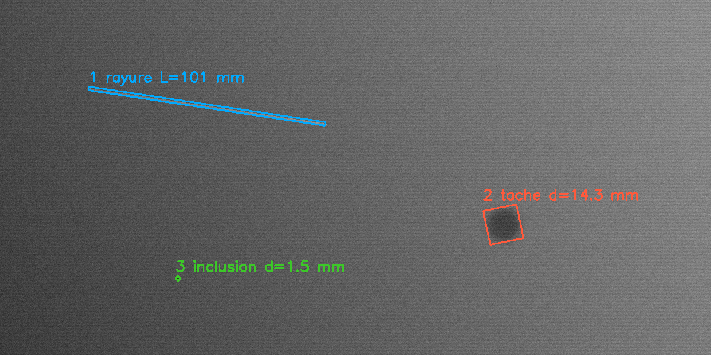
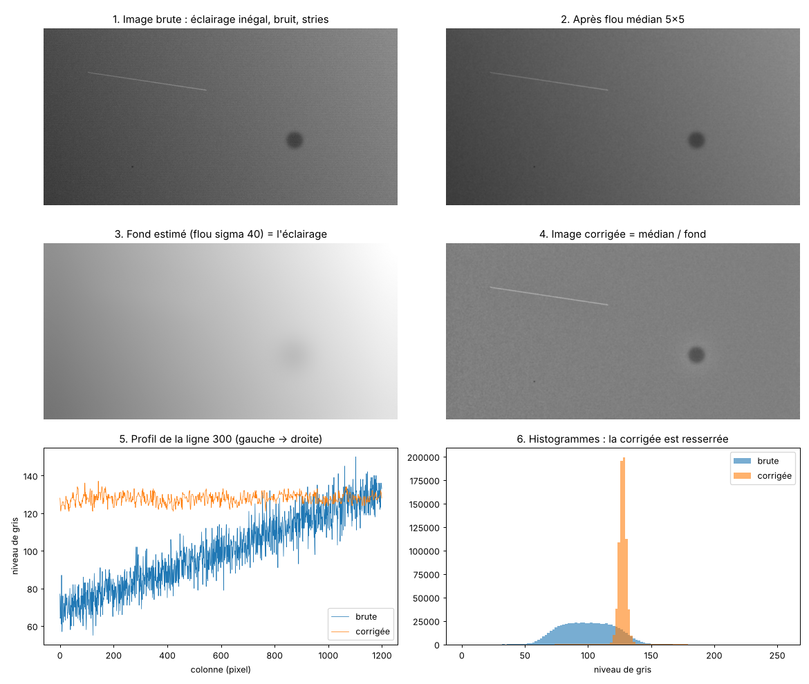
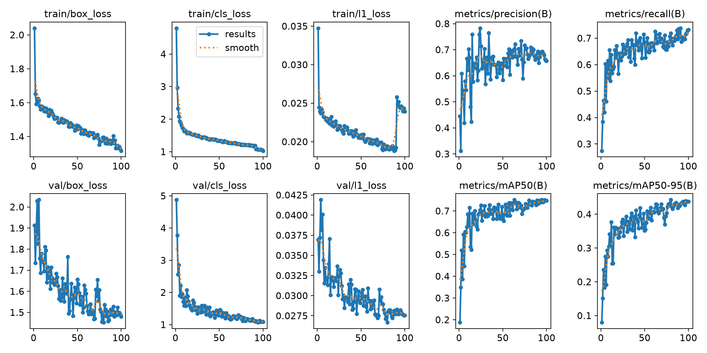
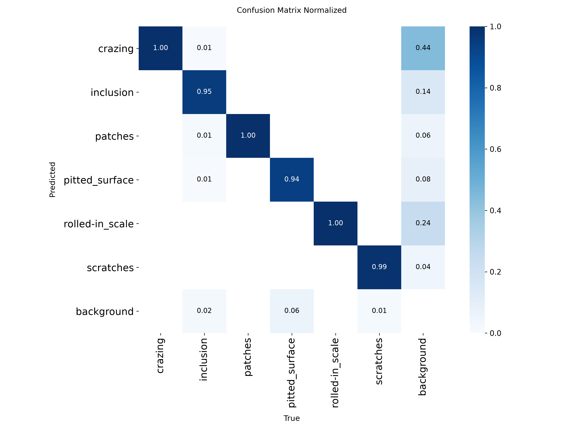
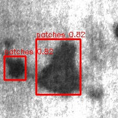

# Inspection de surfaces d'acier : de la caméra au modèle en production

Projet personnel de bout en bout pour l'inspection visuelle de tôles d'acier : acquisition caméra en C# (SDK Basler pylon), traitement d'image classique (OpenCV), détection de défauts par deep learning (YOLO), puis intégration du modèle dans une application opérateur C# / WPF via ONNX Runtime.

> **Contexte.** Projet personnel réalisé en octobre 2026. Chaque brique a été lancée, testée et analysée sur ma machine. La caméra est l'**émulateur** du SDK pylon (pas de caméra physique), et les données sont le jeu public **NEU-DET** (défauts de surface d'acier laminé à chaud). Ce n'est pas un système industriel déployé.



## Architecture

```
Caméra (pylon, émulateur)
   │  callback ImageGrabbed : copie de l'image, rien d'autre
   ▼
File bornée (Channel, 30 images)                 ← producteur / consommateur
   │  file pleine : aucune image jetée en silence,
   │  elle est comptée et journalisée « zone non inspectée »
   ▼
Consommateur : inférence YOLO (ONNX Runtime, C#)  ← try/catch par image
   │
   ├──► Journal (classe, score, boîte, version du modèle, latence, zones non inspectées)
   └──► Interface WPF (affichage limité à ~15 i/s via Dispatcher)

Surveillance : perte de connexion → mode dégradé → reconnexion (1, 2, 4… 30 s)
```

## Contenu

| Dossier | Ce qu'il contient |
| --- | --- |
| [`01_acquisition_csharp`](01_acquisition_csharp) | Acquisition pylon : déclenchement logiciel, producteur / consommateur, robustesse (pannes, reconnexion), séquence motorisée (machine à états + journal CSV) |
| [`02_traitement_classique`](02_traitement_classique) | Pipeline OpenCV en Python puis en C# (OpenCvSharp) : correction d'éclairage, seuil statistique (médiane / MAD), morphologie, mesure des défauts, filtre FFT, limites du classique |
| [`03_deep_learning`](03_deep_learning) | Préparation NEU-DET (VOC → YOLO, split par classe), entraînement YOLO (YOLO26 par défaut, essais versionnés), détection d'anomalies type PatchCore, analyse des erreurs et seuils par classe |
| [`04_integration_csharp`](04_integration_csharp) | Inférence ONNX en C# (prétraitement letterbox, décodage, NMS) validée contre Python, et application WPF complète : caméra + modèle + seuils par classe + journal CSV des détections |

## Résultats

**Traitement classique** (tôle synthétique, 0,25 mm/pixel, vérité terrain connue) : rayure, tache et inclusion retrouvées, longueurs mesurées à moins de 3 % de la vérité. Sur une tôle plus difficile (ombre, marquage, pli léger, nid de piqûres), le classique montre ses limites : fausses alarmes et défauts ratés, d'où le passage au deep learning.



**Détection YOLO sur NEU-DET** (6 classes, split 70 / 15 / 15 par classe). Modèle retenu : **YOLO26n**, images de 224 px, 100 époques (meilleure à l'époque 80), 2,4 millions de paramètres. Résultats sur le jeu de **test**, jamais vu pendant l'entraînement ([`docs/resultats/yolo26n_224.json`](docs/resultats/yolo26n_224.json)) :

| Classe | AP@0.5 |
| --- | --- |
| patches (plaques) | 0,958 |
| scratches (rayures) | 0,931 |
| inclusion | 0,791 |
| pitted_surface (piqûres) | 0,778 |
| rolled-in_scale (calamine incrustée) | 0,617 |
| crazing (craquelures) | 0,377 |
| **Moyenne (mAP@0.5)** | **0,742** |

mAP@0.5:0.95 : 0,431. Précision 0,69, recall 0,68 au seuil par défaut. Essais précédents : YOLO11n en 224 px, puis YOLO11s en 320 px (mAP@0.5 ≈ 0,71 en validation). Un modèle plus gros et des images plus grandes n'apportaient rien ; la génération de modèle la plus récente, en version nano, fait mieux.

| Courbes d'entraînement | Matrice de confusion (test) |
| --- | --- |
|  |  |

Ce que l'analyse des erreurs a montré : les classes les plus faibles (craquelures, calamine incrustée) sont bien **reconnues** mais mal **délimitées**. Leurs défauts n'ont pas de bord net, et l'annotation des boîtes est ambiguë. La piste d'amélioration est donc côté données (règle d'annotation : une boîte par groupe de craquelures), pas un modèle plus gros. Même avec YOLO26n, les craquelures restent à 0,38 : changer de modèle ne règle pas un problème d'annotation.

**Intégration C#** : le modèle exporté en ONNX donne en C# les mêmes détections qu'en Python (mêmes classes, scores à 0,01 près, boîtes à 1 ou 2 px près). Latence d'inférence mesurée sur ma machine avec le modèle précédent (YOLO11s) : environ 7,6 ms en C# contre 9,5 ms en Python (échauffement puis moyenne de 20 passages).



## Lancer le projet

**Prérequis** : Windows, .NET 8 SDK, [Basler pylon](https://www.baslerweb.com/fr-fr/software/pylon/) (pour l'émulateur), Python 3.10+ et `pip install -r requirements.txt`.

1. **Émulateur caméra** : définir la variable d'environnement `PYLON_CAMEMU=1`, puis rouvrir le terminal.
2. **Acquisition C#** : `cd 01_acquisition_csharp/AcquisitionSimulee` puis `dotnet run`. Si `Basler.Pylon.dll` n'est pas trouvée, adapter `<PylonAssembly>` dans le `.csproj`.
3. **Traitement classique** : `cd 02_traitement_classique/python`, puis `python generer_tole.py` et les scripts `etape1` à `etape6` dans l'ordre.
4. **Deep learning** : `pip install -r requirements.txt`, télécharger NEU-DET (non inclus dans le dépôt), puis `python etape3_preparer_neu.py CHEMIN_NEU` et `python etape3_entrainer.py` (GPU conseillé ; `--modele yolo11n.pt` pour comparer). `etape5_analyse_erreurs.py` écrit `seuils_par_classe.json`, que l'application C# charge s'il est posé à côté du modèle.
5. **Application WPF** : dans `04_integration_csharp/InspectionWpf`, créer un dossier `donnees` avec le modèle `best.onnx` et un sous-dossier `images` (quelques images de `neu_yolo/images/test`). Il est copié à côté de l'exécutable à la compilation. Puis `dotnet run` et **Démarrer** : la caméra émulée envoie les images du dossier, et le journal indique au démarrage le modèle chargé et le dossier lu.
   Les variables `INSPECTION_MODELE` et `INSPECTION_IMAGES` permettent de pointer vers d'autres emplacements, par exemple un dossier au chemin simple comme `C:\demo_inspection`.

## Ce que j'en retiens

- Le découplage acquisition / traitement est ce qui rend le système robuste : on change le modèle sans toucher à la caméra, et les pertes d'images sont comptées au lieu d'être cachées.
- L'éclairage et la résolution (mm par pixel) fixent la limite de toutes les méthodes : avec 0,25 mm/px, des rayures de 0,3 et 0,6 mm font toutes les deux 2 pixels de large.
- Un modèle entraîné sur NEU-DET ne se transpose pas tel quel sur une autre ligne (changement de domaine) : il faudrait des images et des annotations du site.
- En production, sans vérité terrain, il faut surveiller des indicateurs indirects : statistiques d'image, distribution des scores, détections par heure, retours opérateurs.

## Pistes d'amélioration

- **Données** : réannoter les craquelures avec une règle explicite (une boîte par groupe de craquelures proches), puis mesurer l'accord entre deux annotateurs avant de réentraîner.
- **Domaine** : ajouter des images de la ligne cible, même peu nombreuses, et faire le découpage train / test par bobine pour éviter les fuites.
- **Débit** : pour une caméra linéaire 16k, l'inférence tuile par tuile ne suffit pas. Il faudrait un GPU (ONNX Runtime CUDA ou TensorRT), des lots de tuiles, et une présélection par le traitement classique.
- **Surveillance en production** : suivre la luminosité moyenne, la distribution des scores et le nombre de détections par heure, et alerter en cas de dérive.
- **Déploiement** : faire tourner un nouveau modèle en mode shadow à côté de l'ancien, avec un test automatique C# contre Python avant chaque mise en service.

## Auteur

Ali Yaghi, ingénieur vision par ordinateur et développement logiciel, Marseille.
